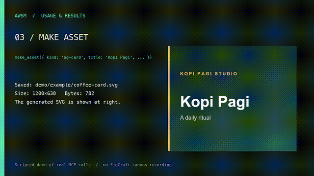

# AWSM

**One MCP connection. A practical toolkit for building better interfaces.**

AWSM is a local [Model Context Protocol (MCP)](https://modelcontextprotocol.io/) server for coding agents. It brings UI design utilities, asset discovery, FigCraft-to-code handoff, and browser-based visual QA into **one MCP entry**. An optional gateway can forward calls to other trusted, locally installed MCP servers, with on-demand SolidCraft discovery for 3D CAD work.

No hosted service or VPS is required. AWSM runs on your computer over stdio.



<sub>Demo of built-in tools; gateway connections and FigCraft editing are configured separately.</sub>

[Get started](#quick-start) · [Connect other MCPs](#connect-other-mcps) · [Explore tools](#whats-included) · [Updates](#updates-and-existing-installations) · [GitHub issues](https://github.com/rikoarik/artcraft-mcp-awsm/issues)

---

## How it works

```text
┌───────────────────────────────────────────────────────┐
│ Coding agent (OpenCode, Claude Code, Codex, etc.)     │
└─────────────────────────┬─────────────────────────────┘
                          │ one MCP connection (stdio)
                          ▼
                   ┌─────────────┐
                   │  AWSM MCP   │
                   └──────┬──────┘
                          │
            ┌─────────────┴─────────────┐
            ▼                           ▼
    Built-in design tools        Optional MCP gateway
    • assets and icons           • bridge_list
    • typography and tokens      • bridge_call
    • FigCraft handoff                   │
    • browser visual QA                 ▼
                               Configured local MCPs
                               (e.g. FigCraft server)
```

**One connection does not mean one tool or one process.** AWSM exposes small, typed tools within a single MCP server. Third-party MCPs remain independent processes, launched only when explicitly configured.

AWSM complements your coding agent: the **agent implements and fixes code**; AWSM supplies design utilities, integration access, and evidence from rendered UI. It is not an autonomous coding agent or a replacement for the FigCraft MCP.

## Quick start

**Requirements:** Node.js 18+, `npx`, and an MCP-compatible coding agent.

Run this inside the project where you use your agent:

```bash
npx -y github:rikoarik/artcraft-mcp-awsm setup \
  --client opencode \
  --source github:rikoarik/artcraft-mcp-awsm
```

Restart the coding agent or reconnect its MCP servers. You should see **`awsm`** as one MCP connection, with the `awsm-design` skill installed.

For OpenCode V2, verify the local connection with `opencode mcp list` or the `/mcps` view. AWSM's installer writes the entry under `mcp.servers.awsm` in `.opencode/opencode.json`.

> AWSM currently installs from GitHub; it is **not published to npm** under `my-awsm-mcp`. The setup command downloads/builds and executes the GitHub source. Review code before running third-party packages.

### Choose your agent

Replace `opencode` with the client you actually use:

| Client | `--client` | MCP configuration created |
| --- | --- | --- |
| OpenCode | `opencode` | `.opencode/opencode.json` |
| Claude Code | `claude` | `.mcp.json` |
| Codex | `codex` | `.codex/config.toml` |
| Google Antigravity | `antigravity` | `.agents/mcp_config.json` |
| GitHub Copilot CLI | `copilot` | `.github/mcp.json` |
| Zed | `zed` | User-level Zed settings with `--global` |

Use `--client all` only if you really need multiple clients. For Zed, `--global` configures the MCP entry; project-level setup can still install the skill separately. Restart the relevant client after setup.

### Try your first task

Give the agent a real interface request instead of asking it to test every AWSM tool:

> Design and implement a construction-project dashboard in this existing app. Reuse its components and styles, use AWSM for missing icons or assets, and check the mobile and desktop render. Build working UI rather than stopping at a plan.

The default installation provides **one skill**, `awsm-design`, to guide that workflow. AWSM's individual tools remain available when the agent needs them.

## What's included

| Capability | What it helps with | Key tools |
| --- | --- | --- |
| Project context | Inspect an existing UI repo and plan a fast first render | `inspect_ui_project`, `design_quickstart` |
| Icons and images | Find, download, and prepare visual assets | `find_design_assets`, `find_icons`, `get_icon`, `find_images`, `save_icon_set`, `download_asset` |
| Design foundations | Work with local fonts, palette, observed tokens, and contrast | `google_font`, `palette`, `extract_design_tokens`, `check_contrast` |
| FigCraft handoff | Classify inspected layers and copy exported artwork into a web project | `prepare_web_handoff`, `sync_figcraft_assets` |
| Visual QA | Inspect a running UI and compare screenshots at matching viewports | `review_ui`, `audit_ui_page`, `capture_ui_screenshots`, `compare_ui_screenshots` |
| MCP connections | Discover and invoke configured third-party tools | `bridge_list`, `bridge_call` |

Additional utilities include `draw_icon`, `make_asset`, and `serve`. In total, AWSM currently exposes **23 MCP tools** through one server.

### FigCraft → working UI

When a FigCraft document is available:

1. Use the **actual FigCraft MCP** to inspect the document and export artwork. AWSM does not edit the FigCraft canvas.
2. Pass the inspected layer data to `prepare_web_handoff` to classify text, layout, components, and exportable assets.
3. Run `sync_figcraft_assets` after the native exports exist.
4. Let the coding agent implement semantic HTML/components with editable text and functioning interactions.
5. Compare a running page to a same-size reference image using `review_ui`, if local Playwright is available.

This workflow is deliberately **design-to-code**, not a one-click pixel-perfect export.

## Connect other MCPs

The gateway is **optional**. Without additional configuration, AWSM's built-in tools still work.

If you want the coding agent to connect **only to AWSM**, you can let AWSM start trusted downstream **stdio MCP servers**, then discover and call their tools through `bridge_list` and `bridge_call`.

### 1. Install the downstream MCP separately

For example, install a FigCraft MCP server using its own instructions. Obtain its **real launch command**, arguments, and tool names. AWSM does **not** install third-party MCPs or automatically read your other clients' configurations.

### 2. Create `.awsm/bridges.json`

Place the file in the working directory from which AWSM starts:

```json
{
  "version": 1,
  "servers": {
    "figcraft": {
      "command": "node",
      "args": ["/absolute/path/to/figcraft-mcp-entry.js"],
      "allowedTools": ["exact_tool_name_from_figcraft"]
    }
  }
}
```

**This is a configuration template, not a verified FigCraft command.** Replace both the file path and tool names with the values supported by your installed provider. Other stdio servers may use different executables and arguments.

If AWSM starts from another directory, set `AWSM_BRIDGE_CONFIG` to an **absolute file path** pointing to the JSON configuration. Restart AWSM after changing the file.

### 3. Discover, then call

Ask the coding agent to:

```text
Use AWSM bridge_list with connect=true.
List the available tools for the configured "figcraft" server.
Then use bridge_call with the exact tool name and required arguments.
Do not invent tool names or modify the FigCraft document unless requested.
```

At the MCP level the workflow looks like:

```js
bridge_list({ connect: true })

bridge_call({
  server: "figcraft",
  tool: "exact_tool_name_from_figcraft",
  arguments: { /* use the discovered tool schema */ }
})
```

The bridge returns downstream MCP content, including text or images when supported. It does **not** automatically expose every downstream tool as a new top-level tool.

**Security and limits**

- Only **explicitly configured local stdio MCP servers** are supported. Direct HTTP/SSE proxying is not implemented.
- `allowedTools` restricts what AWSM can call. Avoid `["*"]` unless you trust every action exposed by that server.
- Child servers execute with your local account's permissions and may inherit your process environment. Review commands, environment variables, and provider trust.
- Third-party tools can perform writes or destructive actions. Use the coding agent's normal approval process.
- Missing or failed downstream MCPs do not disable AWSM's built-in utilities.

### SolidCraft: installed-only 3D CAD integration

AWSM can automatically **discover an installed SolidCraft CLI** in your system `PATH`. You do **not** need to configure another MCP entry in OpenCode, copy SolidCraft's skills, or add a new AWSM tool. SolidCraft's own MCP remains responsible for its parametric CAD engine.

1. Install SolidCraft from [its official website](https://solidcraft.io/download) and ensure `solidcraft-cli` is available on `PATH` (or specify the full executable through the optional config below).
2. Restart AWSM after installation. Call `bridge_list({server:"solidcraft"})` to see the detected integration **without starting SolidCraft**.
3. When you request 3D modeling, the coding agent can run `bridge_list({server:"solidcraft",connect:true})`. AWSM lazily launches `solidcraft-cli mcp --param-check strict` and forwards tool calls through `bridge_call`. This works headlessly or connects to the running SolidCraft desktop app according to SolidCraft's own behavior.

Auto-discovery does **not** auto-install SolidCraft, read app files, change a design, or start a CAD engine at AWSM startup. It discovers an installed executable only. To disable automatic detection, set `AWSM_AUTO_SOLIDCRAFT=0` in the AWSM process environment.

For a custom path or a tighter tool allowlist, add the following server to `.awsm/bridges.json`. An explicitly configured `solidcraft` entry takes precedence over auto-discovery:

```json
{
  "version": 1,
  "servers": {
    "solidcraft": {
      "command": "/absolute/path/to/solidcraft-cli",
      "args": ["mcp", "--param-check", "strict"],
      "allowedTools": [
        "list_commands",
        "describe_command",
        "skill_reference",
        "inspect_design",
        "measure",
        "screenshot",
        "execute",
        "batch",
        "save",
        "export"
      ]
    }
  }
}
```

The `awsm-design` core skill now guides the agent through **SolidCraft's native modeling and checking skills** (accessible through `skill_reference`), including dimensioned sketches, constrained parameters, named features, staged batches and geometric measurement. For presentation-quality results, it guides deliberate camera framing, coherent material/opaque PBR appearances, and native screenshot/product-render workflows. This does **not** add 3D modeling algorithms to AWSM or guarantee stylistic fidelity without examining the rendered result.

Official technical references: [SolidCraft MCP](https://github.com/tangency-labs/solidcraft/blob/main/docs/mcp.md), [modeling skill](https://github.com/tangency-labs/solidcraft/tree/main/skills/solidcraft-modeling), [checking skill](https://github.com/tangency-labs/solidcraft/tree/main/skills/solidcraft-checking), and [product renders](https://github.com/tangency-labs/solidcraft/blob/main/docs/render-jobs.md).

### Matching a requested 3D style

**The current AWSM skill can guide a coding agent to match a 3D style; it is not an automatic reference-image-to-CAD converter.** When a user provides a visual reference that the agent can view, the `awsm-design` skill asks the agent to translate it into a compact style direction *before* modeling: silhouette, proportions, edge treatment, detail density, palette, surface finish, and camera/framing. If no image is accessible, use the text brief and do not claim image-based matching.

For example, an industrial-machined enclosure should use editable thicknesses, purposeful chamfers and restrained metal finishes, whereas a playful rounded desk accessory needs larger corner radii, simpler geometry and coherent matte color blocking. These choices affect **model geometry**, not just render filters. The agent should inspect the actual SolidCraft screenshot, compare it with the reference visually, correct the main mismatches, and re-measure after geometry edits. `review_ui` and pixel-diff tools are for **web UI**, not reliable semantic checks of CAD style.

SolidCraft is strongest for parametric hard-surface and product CAD. It does not become an organic sculptor or a full studio renderer just because AWSM supplies design guidance. Its current opaque PBR/product-image tools do not imply HDRI, refraction, transparent glass, cloth textures or guaranteed photorealism. The final result needs both **geometry validation** and **visible style review**; passing CI alone does not prove visual fidelity.

**Safety:** AWSM uses a constrained built-in allowlist, but `execute` and `batch` can modify the open design and `save`/`export` can write files. Configure the user's normal tool approval process and use SolidCraft's file-access protections. The default integration intentionally does not expose `new_design` or `open`; add them explicitly only when necessary and authorized.

## Browser visual QA

`review_ui` combines a read-only DOM audit, responsive screenshots, and optional comparison against reference PNGs in a single local browser pass.

Install Playwright and Chromium **in the target web project**:

```bash
npm install -D playwright
npx playwright install chromium
```

Start the app's local development server, then ask the agent to run a review:

```js
review_ui({
  url: "http://127.0.0.1:3000/",
  projectRoot: ".",
  outputDir: ".awsm/review"
})
```

Optional reference images can be supplied for pixel comparison, provided their physical dimensions match the capture viewport:

```js
referenceImages: [
  { viewport: "desktop", file: "./figcraft-exports/desktop.png" }
]
```

AWSM reports issues such as horizontal overflow, broken images, missing accessible names, placeholder links, and browser errors. When a reference is supplied it also reports pixel-difference regions.

**What it doesn't do:** edit application code on its own, test every interaction, certify WCAG compliance, or infer semantic design quality from pixels alone. External browser requests are intentionally blocked, which can affect remote font and photo rendering. Check blocked resources before judging fidelity.

## Updates and existing installations

GitHub-source setup enables **best-effort update checks on MCP restart** using `npx --prefer-online`. Managed skill files are synchronized when AWSM starts. User-edited skills are preserved rather than silently overwritten.

This is **not** a background auto-updater. A running MCP session does not receive new code without restart, and caching/network conditions can delay a revision.

To refresh an existing AWSM configuration (including one installed from the old `figcraft-mcp-awsm` GitHub URL), run setup from the **new** repository:

```bash
npx -y --prefer-online github:rikoarik/artcraft-mcp-awsm setup \
  --client opencode \
  --source github:rikoarik/artcraft-mcp-awsm \
  --upgrade-config
```

Use `--no-auto-update` to disable startup revalidation or pin `--source` to a Git commit/tag for reproducible installations.

AWSM installs **one default skill**. The optional specialist library can be installed with `--all-skills`. Existing specialist skill folders are **not deleted** when returning to core mode.

| Installer option | Purpose |
| --- | --- |
| `--client <name>` | Configure a specific agent; default `opencode` |
| `--global` | Install at user level rather than project level |
| `--all-skills` | Install the 21 optional specialist skills alongside `awsm-design` |
| `--upgrade-config` | Update a previously recognized AWSM MCP configuration |
| `--skip-mcp` / `--skip-skills` | Install only skills or only the MCP config |
| `--no-auto-update` | Disable startup package revalidation |
| `--force-skills` | Explicitly overwrite customized skill files; use with care |

If using a **local Git clone** rather than a GitHub-source `npx` entry, updates to that clone require `git pull`, `npm ci`, `npm run build`, and a server restart. A local checkout does not pull changes itself.

## Development

```bash
git clone https://github.com/rikoarik/artcraft-mcp-awsm.git
cd artcraft-mcp-awsm
npm ci
npm test
```

The test script compiles TypeScript and runs MCP smoke tests. Optional Chromium fixture tests live in `test/browser-e2e.mjs` and have a separate GitHub Actions workflow.

For development issues or feature requests, [open an issue](https://github.com/rikoarik/artcraft-mcp-awsm/issues).

### Troubleshooting

- **AWSM not listed in the agent:** confirm setup ran in the same project, inspect the client config, restart the MCP session and check the client's MCP status. For OpenCode V2, run `opencode mcp list`.
- **`bridge_list` returns no servers:** install `solidcraft-cli` on `PATH` for auto-detection, or add a custom server in `.awsm/bridges.json` (or `AWSM_BRIDGE_CONFIG`), then restart.
- **Downstream connection error:** use the provider's launch command directly to verify it works, and check the `allowedTools` names. A provider requiring remote HTTP transport cannot be bridged with this stdio-only gateway.
- **Visual review cannot run:** install Playwright/Chromium in the target project, start the local web server, and use an explicit localhost HTTP URL with a port of at least 1024.

## Scope and licensing

AWSM is an open-source local developer tool under the [MIT License](LICENSE). There is no required paid hosting, but third-party image/font providers can have their own usage terms and rate limits. Verify licensing before using assets commercially.

The local FigCraft MCP, remote HTTP MCP servers, and application-specific code generation are **not bundled** into AWSM. The gateway connects only to downstream MCP processes that you explicitly configure.

---

<sub>Built for coding-agent workflows, from early UI design to evidence-based implementation review.</sub>
